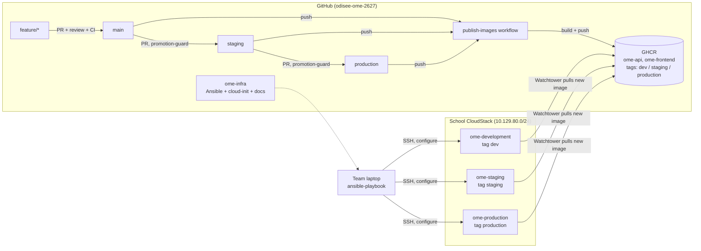
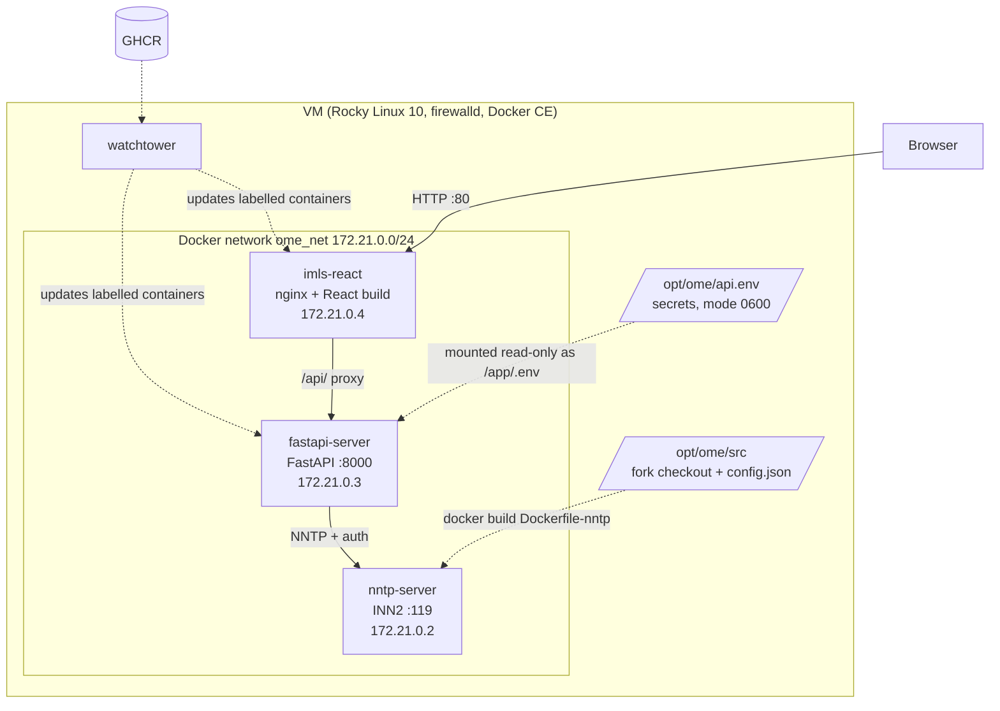
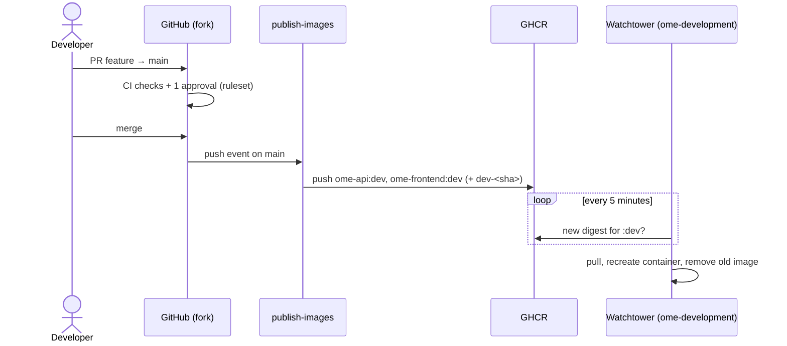

# Architecture

Last updated: 16-10-2026

## Overview

Three environments, each on its own VM on the school's Apache CloudStack. Code flows
through the branches of our fork; every environment follows one branch.

**Who does what**

| Component | Responsibility | Runs when |
|---|---|---|
| `publish-images` (GitHub Actions, fork) | Builds the API and frontend images, pushes them to GHCR | push to `main`, `staging`, `production` |
| `promotion-guard` (GitHub Actions, fork) | Only allows `main → staging` and `staging → production` PRs | PR into `staging` / `production` |
| cloud-init | Creates the `ansible` user on a new VM | first boot only |
| Ansible (`ome-infra`) | Configures the server: packages, firewall, Docker, app, secrets | when infrastructure changes |
| Watchtower (on each VM) | Replaces API/frontend containers when a new image appears for its tag | every 5 minutes |

## Inside one server

### Ports

| Port | Where | Reachable from |
|---|---|---|
| 22/tcp | VM | school network (SSH, Ansible) |
| 80/tcp | `imls-react` | school network (the application) |
| 8000/tcp | `fastapi-server` | Docker network only (through nginx `/api/`) |
| 119/tcp | `nntp-server` | Docker network only. **Never published**: NNTP peering has no authentication. |

Docker publishes ports with its own firewall rules, bypassing firewalld. That is why only the
frontend has a `ports:` entry in the compose file; the firewalld rule for port 80 documents the intent.

### Where the configuration comes from

| Item | Source | Contains secrets? |
|---|---|---|
| API and frontend images | GHCR, built in CI with `config.json.example` | No (example values only) |
| `/opt/ome/api.env` | Ansible template + Vault | Yes, mode 0600, mounted over `/app/.env` |
| NNTP image | built on the VM by Ansible from the fork + rendered `config.json` | Yes, never pushed to a registry |
| Vault password | each admin's `~/.ansible/ome-vault-pass` | — never in Git |

## Deployment flow (dev)

Promotion to staging or production is the same flow, started by a PR `main → staging`
or `staging → production`.
