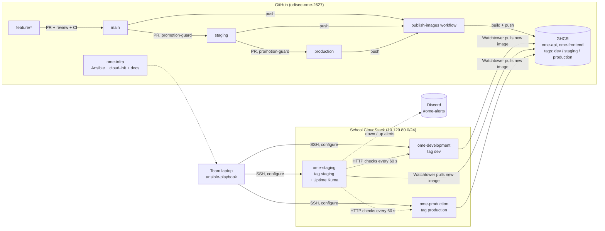
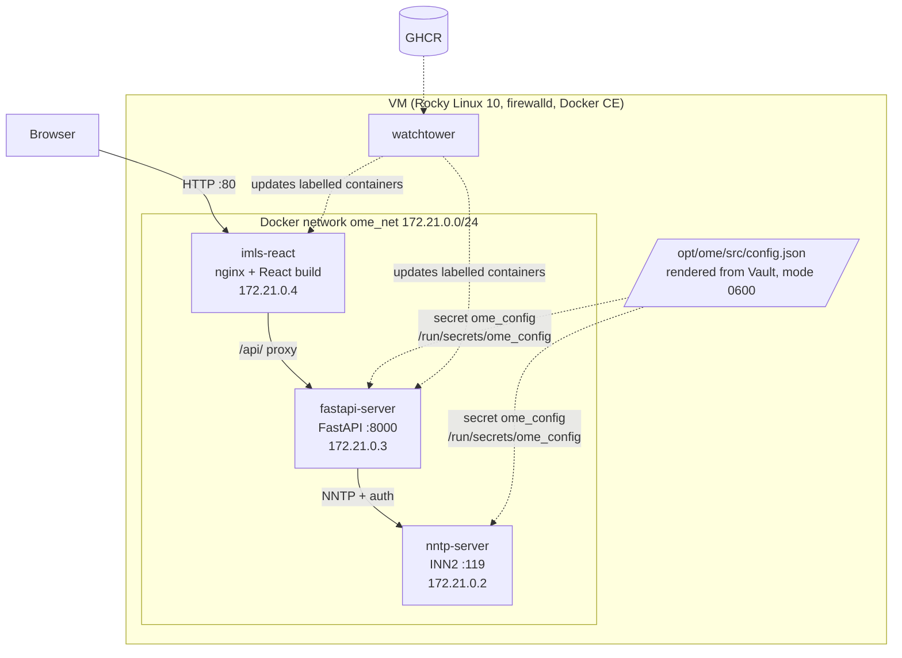

# Architecture

Last updated: 17-10-2026

## Overview

Three environments, each on its own VM on the school's Apache CloudStack. Code flows
through the branches of our fork; every environment follows one branch.

**Who does what**

| Component | Responsibility | Runs when |
|---|---|---|
| `publish-images` (GitHub Actions, fork) | Builds the API and frontend images, pushes them to GHCR | push to `main`, `staging`, `production` |
| `promotion-guard` (GitHub Actions, fork) | Only allows `main → staging` and `staging → production` PRs | PR into `staging` / `production` |
| cloud-init | Creates the `ansible` user on a new VM | first boot only |
| Ansible (`ome-infra`) | Configures the server: packages, firewall, Docker, config, app, monitoring | when infrastructure changes |
| Watchtower (on each VM) | Replaces API/frontend containers when a new image appears for its tag | every 5 minutes |
| Uptime Kuma (on `ome-staging`) | Checks frontend and API of every environment, alerts in Discord | every 60 seconds |

## Inside one server

At start, each container reads `/run/secrets/ome_config` with its entrypoint script: the API
renders its `.env`, NNTP renders the INN configuration. No image contains `config.json`
(ADR 0009).

### Ports

| Port | Where | Reachable from |
|---|---|---|
| 22/tcp | every VM | school network (SSH, Ansible) |
| 80/tcp | `imls-react` | school network (the application) |
| 3001/tcp | Uptime Kuma, `ome-staging` only | school network (monitoring dashboard) |
| 8000/tcp | `fastapi-server` | Docker network only (through nginx `/api/`) |
| 119/tcp | `nntp-server` | Docker network only. **Never published**: NNTP peering has no authentication. |

Docker publishes ports with its own firewall rules, bypassing firewalld. That is why only the
frontend (and Uptime Kuma) have a `ports:` entry; the firewalld rules document the intent.

### Where the configuration comes from

| Item | Source | Contains secrets? |
|---|---|---|
| API and frontend images | GHCR, built in CI from the fork | No |
| NNTP image | built on the VM by Ansible from the fork | No |
| `/opt/ome/src/config.json` | Ansible template + Vault, mode 0600 | Yes; mounted as the `ome_config` secret |
| Vault password | each admin's `~/.ansible/ome-vault-password` | never in Git |
| Discord webhook (alerts) | Uptime Kuma data volume on `ome-staging` | never in Git |

## Deployment flow (dev)

Promotion to staging or production is the same flow, started by a PR `main → staging`
or `staging → production`.

## More

- [`monitoring.md`](./monitoring.md): Uptime Kuma, alerts, logging
- [`scalability.md`](./scalability.md): what scaling concretely means for OME
- [`runbook.md`](./runbook.md): add a server, deploy, roll back, troubleshoot
- [`adr/`](./adr/): the decisions behind all of this