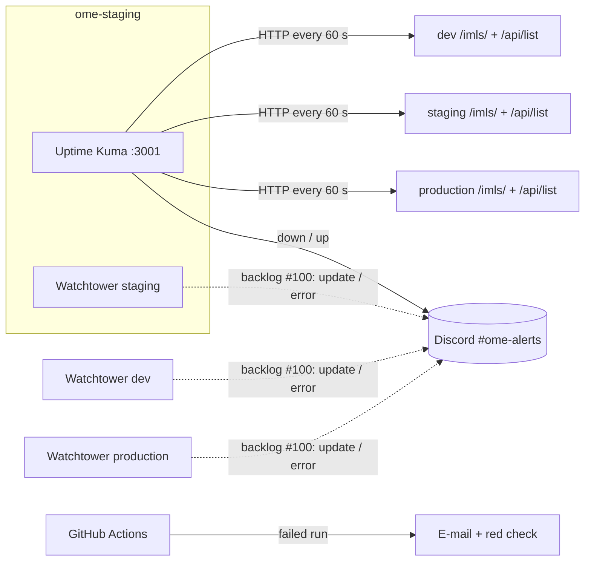

# Monitoring, logging and notifications

Last updated: 17-10-2026

Goal: at any moment it is clear whether each environment is healthy, and problems are
reported **automatically**, without anyone having to look.

## Overview

| What can go wrong | How we notice | Where the alert goes |
|---|---|---|
| An environment stops answering (VM off, container crashed, nginx 502) | **Uptime Kuma** checks every environment every 60 s | Discord `#ome-alerts` |
| A deployment happens, or fails | **Watchtower** logs every check and update (`docker logs`); a broken deploy shows up as a red monitor in Uptime Kuma | Uptime Kuma → Discord (Watchtower → Discord: #100) |
| A build or test fails in CI | **GitHub Actions** marks the run red and emails the person who triggered it | E-mail + red check on the PR |
| A promotion to the wrong branch | `promotion-guard` fails, the ruleset blocks the merge | Red check on the PR |
| Configuration drift on a server | `ansible-playbook` reports `changed` > 0 on a second run | Playbook output |

## Uptime Kuma (availability)

- Runs on `ome-staging` (role `monitoring`, host group `monitoring`, playbook
  `playbooks/monitoring.yml`), at `http://10.129.80.47:3001/`, reachable from the school network.
- Not on production: a monitor that runs on the server it watches goes down with it, and
  nobody is told. From staging, production is watched from the outside.
  Not on dev either: dev is allowed to break.
- Version pinned (`louislam/uptime-kuma:2.5.6`), data in a Docker volume, compose file in
  `/opt/monitoring/docker-compose.yml`. Deploy or update it on its own with:
  `ansible-playbook -i inventories/staging playbooks/monitoring.yml`

| Monitor | Type | URL | Healthy when |
|---|---|---|---|
| dev – frontend | HTTP | `http://10.129.80.46/imls/` | 200 |
| dev – API | HTTP | `http://10.129.80.46/api/list` | 200 |
| staging – frontend | HTTP | `http://10.129.80.47/imls/` | 200 |
| staging – API | HTTP | `http://10.129.80.47/api/list` | 200 |
| production – frontend | HTTP | `http://10.129.80.54/imls/` | 200 |
| production – API | HTTP | `http://10.129.80.54/api/list` | 200 |

The API check uses `/api/list`: it returns the newsgroups from the NNTP server, so one
check proves the whole chain nginx → FastAPI → NNTP works. A 502 means the API is down;
an error from FastAPI usually means NNTP is unreachable.

The dashboard also shows response times and uptime history per environment.

### First-time setup (5 minutes)

1. Open `http://10.129.80.47:3001/`, choose **SQLite**, create the admin account
   (store the password in the team password manager, #99).
2. **Settings → Notifications → Setup Notification → Discord**, paste the webhook URL of
   `#ome-alerts`, enable *Default enabled* and *Apply on all existing monitors*, **Test**.
3. **Add New Monitor** for each row above: type *HTTP(s)*, interval 60 s, retries 2.

Limitation: monitors live in Uptime Kuma's database, not in Git.

## When an alert arrives

1. Open the monitor in Uptime Kuma: the error shows the status code or timeout.
2. On the server: `sudo docker compose -f /opt/ome/compose.yml ps` (is a container restarting?)
3. Read the logs of that container: `sudo docker compose -f /opt/ome/compose.yml logs --tail 50 <service>`
4. Was there a deploy just before? `sudo docker logs --tail 20 ome-watchtower-1`
5. Fix forward (PR) or roll back (runbook §4). Write a short incident note in `docs/incidents/`.

## Proven in practice

On 16-10-2026 the API on dev stopped after a merge on `main` (fork PR #80). Uptime Kuma
reported `dev-api went down` (502) in Discord within a minute; staging and production were
not affected. See [`incidents/16-10-2026-config-secret.md`](./incidents/16-10-2026_config-secret.md).

## Watchtower (deployments)

Every server's Watchtower logs each check and each update (`sudo docker logs ome-watchtower-1`).
A deployment that breaks the application is caught by Uptime Kuma within a minute.

Next step (#100): Watchtower posts every update and error to Discord itself
(`WATCHTOWER_NOTIFICATION_URL`), with the webhook stored in Ansible Vault and rendered into a
0600 env file, never into the compose file.

## Logging

| Where | How to read it |
|---|---|
| Application containers | `sudo docker compose -f /opt/ome/compose.yml logs -f <service>` |
| Deployments | `sudo docker logs -f ome-watchtower-1` |
| Uptime Kuma | web UI, per monitor (history of every check) |
| System, Docker daemon | `sudo journalctl -u docker` |
| CI | GitHub → Actions → run → job log |

Uptime Kuma uses the `json-file` driver with rotation (3 × 10 MB). The application
containers use Docker's default (no size limit); the same rotation for role `ome` is on the backlog.

## Backlog

| Item | Issue |
|---|---|
| Watchtower notifications to Discord | #100 |
| CI failures to Discord | #101 |
| Dedicated monitoring host | #102 |
| API docs reachable on dev/staging (today only via SSH tunnel) | #19 |
| Log rotation for the application containers | to create |
| Resource monitoring (CPU, RAM, disk) | to create |
| Monitors as code (e.g. Gatus, rendered by Ansible) | to create |
| `/api/health` endpoint (proposal for ISKME) | to create |
| Central logs (Loki + Grafana) | later |