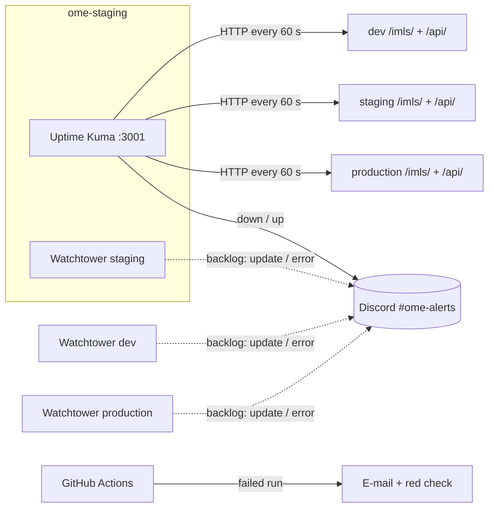

# Monitoring, logging and notifications

Last updated: 16-10-2026

Goal: at any moment it is clear whether each environment is healthy, and problems are
reported **automatically**, without anyone having to look.

## Overview

| What can go wrong | How we notice | Where the alert goes |
|---|---|---|
| An environment stops answering (VM off, container crashed, nginx 502) | **Uptime Kuma** checks every environment every 60 s | Discord `#ome-alerts` |
| A deployment happens, or fails | **Watchtower** logs every check and update (`docker logs`); a failed deploy also shows up as a red monitor in Uptime Kuma | Uptime Kuma → Discord (Watchtower → Discord: backlog) |
| A build or test fails in CI | **GitHub Actions** marks the run red and emails the person who triggered it | E-mail + red check on the PR |
| A promotion to the wrong branch | `promotion-guard` fails, the ruleset blocks the merge | Red check on the PR |
| Configuration drift on a server | `ansible-playbook` reports `changed` > 0 on a second run | Playbook output |

## Uptime Kuma (availability)

- Runs on `ome-staging` (role `monitoring`, host group `monitoring`, playbook
  `playbooks/monitoring.yml`), at `http://10.129.80.47:3001/`, reachable from the school network.
- Not on production: a monitor that runs on the server it watches goes down with it, and
  nobody is told. From staging, production is watched from the outside.
  Not on dev either: dev is allowed to break.
- Version pinned (`louislam/uptime-kuma:2.5.6`), data in a Docker volume, compose file in
  `/opt/monitoring/docker-compose.yml`. Deploy or update it on its own with:
  `ansible-playbook -i inventories/staging playbooks/monitoring.yml`
- Monitors (configured once in the web UI):

| Monitor | Type | URL | Healthy when |
|---|---|---|---|
| dev – frontend | HTTP | `http://10.129.80.46/imls/` | 200 |
| dev – API | HTTP | `http://10.129.80.46/api/` | not 502/503/504 |
| staging – frontend | HTTP | `http://10.129.80.47/imls/` | 200 |
| staging – API | HTTP | `http://10.129.80.47/api/` | not 502/503/504 |
| production – frontend | HTTP | `http://10.129.80.54/imls/` | 200 |
| production – API | HTTP | `http://10.129.80.54/api/` | not 502/503/504 |

The API check accepts `200–499`: any answer from FastAPI (even a 404 on `/api/` itself)
proves that nginx reaches the API. A 502 means the API is down.

The status page also shows response times and uptime history per environment.

### First-time setup (5 minutes)

1. Open `http://10.129.80.47:3001/`, create the admin account
   (store the password in the team password manager).
2. **Settings → Notifications → Setup Notification → Discord**, paste the webhook URL of
   `#ome-alerts`, enable *Default enabled* and *Apply on all existing monitors*, **Test**.
3. **Add New Monitor** for each row above: type *HTTP(s)*, interval 60 s, retries 2.
   For the API monitors set *Accepted Status Codes* to `200-299`, `300-399` and `400-499`.

Limitation: monitors live in Uptime Kuma's database, not in Git. Exporting them as code
(or replacing Kuma by a config-file based tool) is on the backlog.

## Watchtower (deployments)

Every server's Watchtower logs each check and each update (`sudo docker logs ome-watchtower-1`).
A deployment that breaks the application is caught by Uptime Kuma within a minute.

Next step (backlog): Watchtower can post every update and error to Discord itself
(`WATCHTOWER_NOTIFICATION_URL`), with the webhook stored in Ansible Vault and rendered into a
0600 env file, never into the compose file.

## Logging

| Where | How to read it |
|---|---|
| Application containers | `sudo docker compose -f /opt/ome/compose.yml logs -f <service>` |
| Deployments | `sudo docker logs -f ome-watchtower-1` |
| Uptime Kuma | web UI, per monitor (history of every check) |
| System, Docker daemon | `sudo journalctl -u docker` |
| CI | GitHub → Actions → run → job log |

Uptime Kuma uses the `json-file` driver with rotation (3 × 10 MB). The application
containers use Docker's default (no size limit); adding the same rotation to the `ome` role
is on the backlog.

## Backlog

- Central log collection (Loki + Grafana) instead of per-server `docker logs`
- Resource monitoring (CPU, RAM, disk) with alerts, e.g. Netdata or node-exporter
- Watchtower notifications to Discord
- Log rotation for the application containers
- CI failures to Discord (a notify step in `publish-images`)
- Dedicated monitoring host outside the environments it watches (or GCP)
- Monitors as code, e.g. Gatus (YAML config rendered by Ansible from the inventories)
